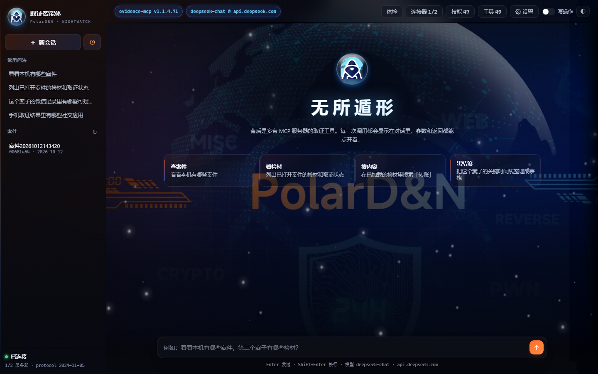
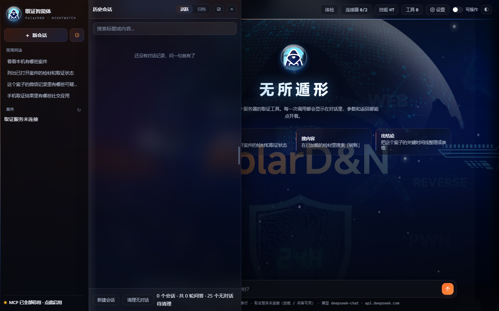

# 电子数据取证智能体 · Forensics Agent

一个能直接干活的电子数据取证 Agent：给一个挂载好的检材路径，它自己列目录、读文件、流式扫关键词、查文件系统索引，最后给出**每条都能回溯到具体证据位置**的结论。

它在真实案件中要守的一条底线是：模型负责找路径，程序负责守证据。

---

## 它解决什么问题

把大模型放进取证流程，会遇到三个卡点，这个项目的每一条设计都对着其中一个：

1. **模型会编。** 问它「这个人的密码是多少」，它可能直接给一个像模像样的值——而司法场景里，一条无证据支撑的结论比没有结论危险得多。
2. **模型会放弃。** 工具报一个 `file_too_large`，它就回「无法读取，请提供更小文件」，然后收工。
3. **模型会乱序。** 一上来跑全盘裸搜，进度卡在 6%，推理轮数烧完，结论为零。

对应三个机制：**证据闸门**、**换路门禁**、**三层成本阶梯**。

## 界面

本地 Web 界面（`python webui.py`，默认 `127.0.0.1:8765`），左侧是会话与常用问法，右侧是对话区，工具调用与返回都以可展开的卡片呈现：



历史会话面板（侧栏收起 / 展开、轮次药丸、亮暗两套主题）：



## 架构

```
        用户：「这个检材里跟转账有关的聊天记录有哪些」
          │
          ▼
    agent.py ── OpenAI 兼容接口 ──▶ DeepSeek / 通义 / Kimi / 本地 vLLM
      │  ▲
      │  └── ReAct 循环：模型自己挑工具 → 读结果 → 决定下一步
      │
      ├── 9 个内置工具（不需要任何外部服务）
      │     ├── sys_fs_list        列目录树
      │     ├── sys_fs_index       查文件系统索引表（秒级定位）
      │     ├── sys_file_read      读文本，自动识别 UTF-8 / GBK / UTF-16
      │     ├── sys_file_scan      流式扫任意大小文件，双编码、防跨块漏
      │     ├── sys_skill_list / sys_skill_read / sys_skill_exec
      │     └── sys_server_status / sys_server_reconnect
      │
      ├── MCP 池（可选）──▶ 商业取证平台 / 逆向工具
      └── 技能注册表（可选）──▶ ./skills 下的 SKILL.md 操作手册
```

**最关键的一条设计：读文件不经过 MCP。**
用户把镜像挂载出来的目录一给，agent 直接读——和人在命令行里做的事完全等价。MCP 只在「查案件、提交解析任务、读插件库、挂载设备」这四类**产品能力**上才用到。所以一台 MCP 都不连，这个 agent 依然完整可用。

## 三个核心机制

### 1. 证据闸门

模型输出硬断言（具体密码、文件名、账号、数量）但本轮**没有任何一次工具调用**支撑时，程序把这条结论拦回，并注入「必须先取证」的强制指令。三种情况都会触发：

- 无工具支撑的硬断言；
- 同一个问题先答「未取得」、后一轮改口给出具体值；
- 引用的值与工具实际返回值不一致。

打回次数**上限 2 次**——闸门是为了纠正，不是为了把用户永久卡死。

### 2. 换路门禁

工具返回类似 `file_too_large` 的阻断时，不允许交白卷：必须换通道（流式扫描 / 复制到本地再读 / 改走平台接口 / 重连服务），并且说明换的是哪条路。同一轮里最多打回 2 次。

### 3. 元问题豁免

判定标准只有一条：**这一问的宾语是「你」，不是某份检材。**
「你能干什么」「怎么用」属于元问题，不该触发取证闸门，也不该答「未取得」——否则会出现「问你能干什么 → 答查不到」这种荒唐输出。

### 三层成本阶梯

| 顺序 | 手段 | 耗时 | 用在哪 |
|---|---|---|---|
| ① | 查文件系统索引 | 秒级 | 「某文件 / 某目录在哪」——几乎所有题的起点 |
| ② | 读文件 | 秒级 | 账号、启动参数、部署记录、版本号 |
| ③ | 流式扫盘 | 分钟级 | 镜像内搜关键字 |
| ④ | 裸数据检索 | 十几分钟起 | 前三层都定位不到时才用 |

**倒过来用就是「一道题都跑不出来」的根因**：直接上 ④，进度卡在 6%，轮数烧完，而 ① 只要 1 秒。这条写死在 `prompts/system.md` 的「三层成本阶梯」和铁律里。

### 教训库

被闸门打回、交白卷、自称没工具、工具熔断、用户插话纠正、撞墙——六类事件自动沉淀成条目回注提示词，优先级为
**用户纠正 > 闸门打回 > 工具熔断 > 撞墙**。它**不改模型权重，也不碰闸门判定**：那三条是硬边界，被「学习」改掉就是灾难。

## 快速开始

```bash
git clone <this-repo> && cd <repo>
cp config.example.json config.json

# 方式一：环境变量给 key（优先级高于 config.json）
export MYOS_LLM_API_KEY=sk-xxxx        # Windows: set MYOS_LLM_API_KEY=sk-xxxx

# 纯命令行，不起服务、不监听端口、不连任何 MCP
python agent.py -p "检材挂在 /path/to/Laptop.E01/系统 ，找一下邮箱账号"

# 网页界面
python webui.py      # http://127.0.0.1:8765/
```

没有 key 也能用：界面里「工具」面板可以手动调全部工具，「技能」面板直接跑命令行工具，两者都不经过大模型。

## 目录结构

```
agent.py              ReAct 主循环 / 工具调度 / 闸门判定 / 上下文管理
skills.py             技能注册表（按 SKILL.md 入库，按厂商分组）
webui.py              本地 Web 界面
settings_store.py     配置原子读写 + 连通性测试
sessions.py           会话与历史（logs/<id>.jsonl）
learn.py              教训库：事件分类、优先级、回注
prompts/system.md     运行时方法论（角色、铁律、三条流水线、成本阶梯）
AGENT.md              给人看的方法论手册
ui/                   前端（原生 JS + CSS）
scripts/test_*.py     闸门与路由的回归脚本
```

## 测试

闸门行为是可回归验证的，不是口头设计：

```bash
python scripts/test_evidence_gate.py    # 编造的证据链会不会被拦
python scripts/test_route_gate.py      # 撞到 file_too_large 会不会交白卷
python scripts/test_meta_ask.py        # 元问题会不会误触发闸门
python scripts/test_learn.py           # 教训库分类与优先级
python scripts/test_stuck_fixes.py     # 卡死场景的收口行为
```

## 这个仓库里没有什么（以及为什么）

- **技能库 `skills/`**：里面是厂商软件与真实检材样本（1.5 GB），涉及版权和案件数据，不随仓库分发。格式很简单：一个含 `SKILL.md` 的文件夹丢进去就自动入库。
- **`config.json`**：含 API Key，已进 `.gitignore`；仓库只带 `config.example.json`。
- **`logs/` 与真实检材路径**：会话留痕里有案件信息与本地路径，一律不入库。
- **厂商接口的完整工具清单**：属于商业产品的接口面，仓库只保留通用工具注册表与适配约定。

## 设计取舍与已知限制

- **单文件主循环**：`agent.py` 约 200 KB，没有拆包。取舍是「一人可维护、改闸门不用跨五个文件」，代价是可读性。
- **闸门基于启发式判定**：识别的是「这句话像不像硬断言」，会有漏拦和误拦；误拦的代价是一次多余的取证，漏拦的代价是一条假结论——这个不对称是故意选的。
- **强依赖路径质量**：用户给的挂载目录越明确，效果越好；只给「一个 40 GB 的镜像」时，前十分钟基本都在做定位。
- **不做远程攻击、不做反取证**，只输出技术事实：看到了什么、在哪看到的、用什么方法看到的。

## License

MIT
